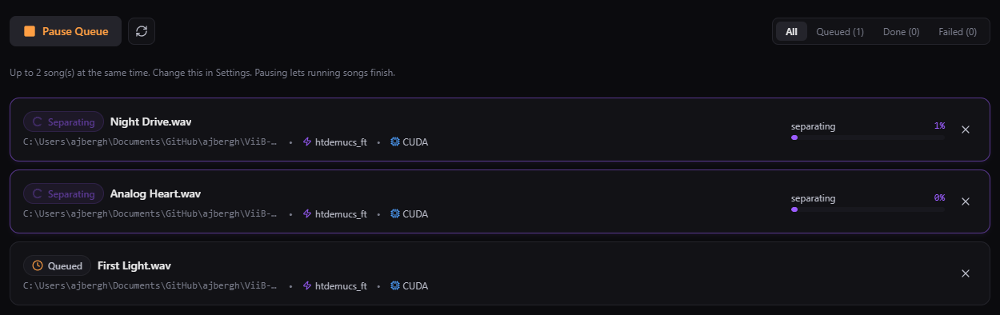
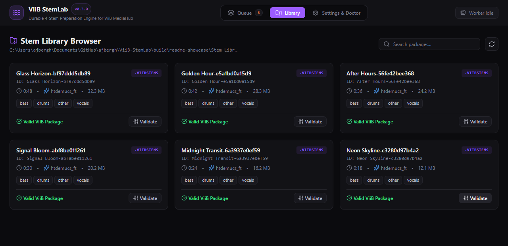

  

<h1 align="center">ViiB StemLab</h1>

  <strong>Your tracks. Four stems. More room to mix.</strong> 
  Separate vocals, drums, bass and other instruments on your own machine. 
  Build a stem library for ViiB MediaHub before your next set.

  <a href="https://github.com/ajbergh/ViiB-StemLab/releases/tag/v0.3.0"><strong>Download 0.3.0</strong></a>
  · <a href="#get-stemlab">Choose your installer</a>
  · <a href="docs/README.md">Documentation</a>

<em>Queue your tracks, follow the separation, and get your music ready in layers.</em>

## More possibilities in every track

Bring a vocal forward. Make space for a bassline. Build a transition around the drums. StemLab prepares the layers for [ViiB MediaHub](https://github.com/ajbergh/ViiB-MediaHub), so you can spend your session mixing with the results.

Add individual tracks or a whole folder, choose where your stems go, and let the queue handle the preparation. Audio processing stays on your machine.

**Vocals · Drums · Bass · Other**

- **Prepare a set or a whole collection.** Add WAV, FLAC, MP3 or OGG files in batches. A persistent queue keeps the work organized, with progress, cancellation and retry controls.
- **Put your hardware to work.** Process up to three songs at once. Choose CPU, optional NVIDIA acceleration on Windows, or Metal/MPS on supported Apple Silicon Macs.
- **Keep preparing offline.** The Full installer includes the CPU engine and model. On-demand downloads verified components once and caches them for reuse.
- **Make room for your library.** Keep four aligned WAV stems, or choose smaller OGG/MP3 output when disk space matters.
- **See what is ready to play.** Browse completed packages, search your library, and validate results before bringing them into MediaHub.

## From music folder to stem library

1. **Add your music.** Drop files or folders into the desktop app, or use the native file picker.
2. **Choose your setup and start processing.** Pick an output folder, stem format and processing device. Run one, two or three songs at a time to suit your machine.
3. **Take the results into your mix.** Browse the finished four-stem packages, validate them, and add them to MediaHub.

<em>From queued tracks to an organized library of validated stem packages.</em>

Screenshots show real CUDA processing and completed packages made from original generated demo audio in the browser-hosted UI. The desktop app adds native file dialogs and drag-and-drop. [Capture details](docs/images/README.md).

## Get StemLab

| Platform | Full — engine and model included | On-demand — smaller download |
| --- | --- | --- |
| **Windows x64** | [Download Full](https://github.com/ajbergh/ViiB-StemLab/releases/download/v0.3.0/ViiB-StemLab_0.3.0_x64-full-setup.exe) | [Download On-demand](https://github.com/ajbergh/ViiB-StemLab/releases/download/v0.3.0/ViiB-StemLab_0.3.0_x64-ondemand-setup.exe) |
| **Apple Silicon · macOS 14+** · experimental | [Download Full DMG](https://github.com/ajbergh/ViiB-StemLab/releases/download/v0.3.0/ViiB-StemLab_0.3.0_arm64-full.dmg) | [Download On-demand DMG](https://github.com/ajbergh/ViiB-StemLab/releases/download/v0.3.0/ViiB-StemLab_0.3.0_arm64-ondemand.dmg) |
| **Linux x64 · Debian package** · experimental | [Download Full DEB](https://github.com/ajbergh/ViiB-StemLab/releases/download/v0.3.0/ViiB-StemLab_0.3.0_amd64-full.deb) | [Download On-demand DEB](https://github.com/ajbergh/ViiB-StemLab/releases/download/v0.3.0/ViiB-StemLab_0.3.0_amd64-ondemand.deb) |

Choose **Full** to get the CPU engine, decoders and model together. Choose **On-demand** for a smaller installer that downloads those components during setup. Windows GPU acceleration is a separate optional download with either installer. No separate Python installation is needed.

[All downloads, SHA-256 checksums and release notes](https://github.com/ajbergh/ViiB-StemLab/releases/tag/v0.3.0) · [Installer guide](docs/INSTALLERS.md)

<strong>Platform notes</strong>

- Windows installers are unsigned. Both CUDA profiles have been tested on an RTX 4060 Ti; other NVIDIA hardware and driver combinations remain unverified. See [GPU compatibility](docs/GPU_PLATFORMS.md).
- Apple Silicon builds require macOS 14+. They are experimental and ad-hoc signed without Developer ID notarization, so Gatekeeper may block opening them. Intel Mac builds are not included.
- Linux packages target x64 Debian systems with an Ubuntu 22.04 build baseline and CPU processing. Other distributions, ARM64, AppImage and RPM are not covered. See [Linux installation](docs/LINUX_PACKAGING.md).
- Clean-machine GUI installation and broader hardware testing remain unverified. Read the [release validation record](docs/RELEASE_0_3_0_PROGRESS.md) for the exact coverage.

## Prepare once, keep the results

Each `.viibstems` package carries four aligned stems and the information MediaHub needs to use them. StemLab can be closed while you play completed packages in MediaHub. Existing six-stem packages remain readable; new 0.3.0 generation uses the four-stem `htdemucs_ft` model.

WAV is the default. OGG and MP3 are lossy, use less disk space, and require a MediaHub version that supports `compressed-stems-v1`. [Learn about the package format](docs/VIIB_STEM_PACKAGE_V1.md).

## Explore further

- [Development and CLI reference](docs/DEVELOPMENT.md) — source setup, batch commands, model management and package tools.
- [Documentation index](docs/README.md) — architecture, workflows and integration details.
- [Standalone desktop development](docs/STANDALONE_DESKTOP.md) — native builds and runtime lifecycle.
- [Roadmap](ROADMAP.md) — what is implemented and what comes next.
